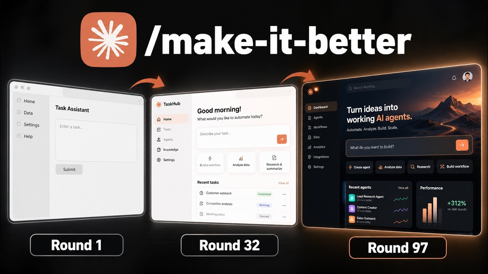
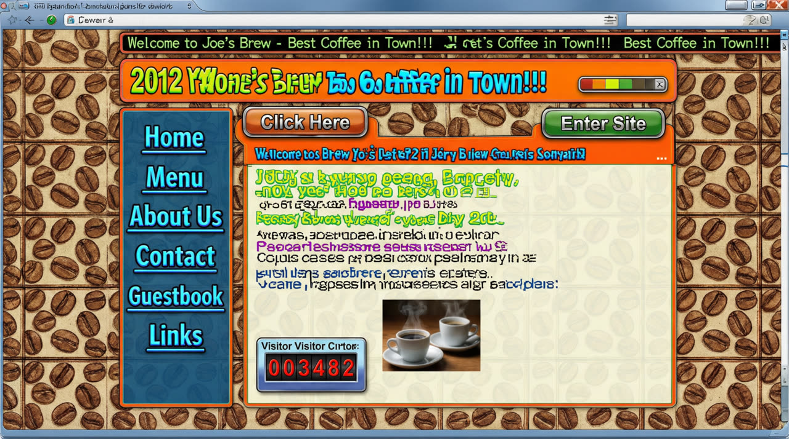
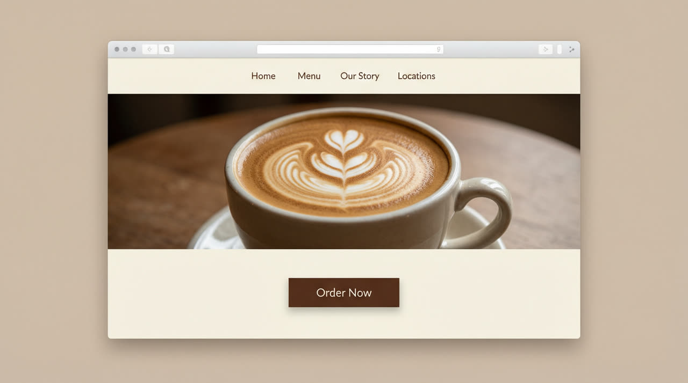
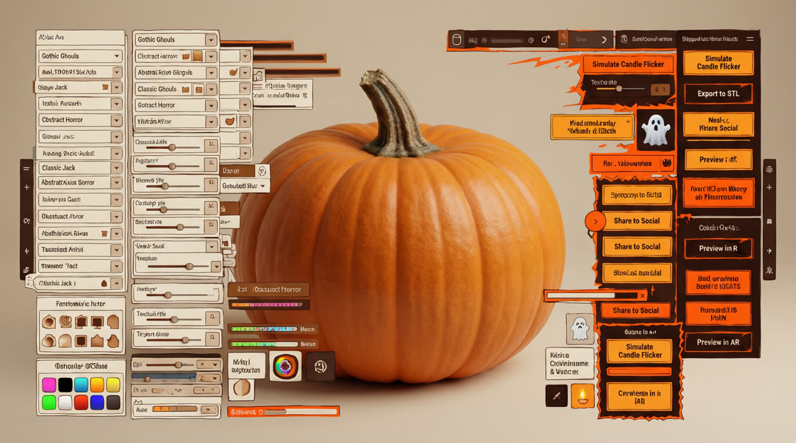

<div align="center">


# tasteeship ☕🚢

**A local Node CLI harness that runs a recurring "make it better" code-change
loop — with your taste, a hard stop condition, and a dashboard with the kill
button the reference video didn't have.**

[](https://nodejs.org)
[](package.json)
[](#validation-on-the-case-study)
[](LICENSE)

</div>

Inspired by Nate Herk, *"I Told Claude to 'Make it better' 100 Times (It Went
Too Far)"* ([▶ watch the reference video](https://www.youtube.com/watch?v=DByAR5Su1Yw) ·
[metadata](docs/assets/launch-video.json) · thumbnail © Nate Herk, used as a
reference thumbnail):

<div align="center">
<a href="https://www.youtube.com/watch?v=DByAR5Su1Yw"></a>
</div>

Give a coding agent an ugly coffee-shop site and the prompt *"look at the site,
innovate, make one bold change that improves conversions, you must ship a
change every time"* — 100 rounds. The loop works, but *"must ship a change"*
forces over-engineering (round-100 Opus: ~21k LOC, broken forms, a
pumpkin-carving feature, a language toggle that didn't work), and the gate —
not the model — should decide when to stop.

<div align="center">
<table><tr>
<td><sub><b>before</b> — what the loop starts from</sub></td>
<td><sub><b>after</b> — a few rounds in: form works, nothing broken</sub></td>
</tr></table>
</div>

The one-liner:

> Each project attaches its own repo, keys, and a `rules.md` of taste; every
> step runs a bounded number of agent outputs, then halts and reports —
> halting on regression, over-build, or user rejection — rather than forcing
> another change.

Zero runtime dependencies. Node ≥ 18. Single user, local machine.

---

## What the harness does, every round

```
                ┌────────────────────────────────────────────────────────┐
                │  ORCHESTRATION (the only place that can stop)          │
 rules.md ────▶ │                                                        │
 .env.local ──▶ │   assemble context ───▶ agent output #N                │
 your repo ───▶ │        │                      │                        │
                │        │               apply proposal (full-file      │
                │        │                 writes onto a checkpointed   │
                │        │                 tree — idempotent)           │
                │        ▼                      ▼                        │
                │   VERIFICATION ──────── verdict ──▶ ship / retry /     │
                │   (Node, not the model)               halt + rollback  │
                │        │                      │                        │
                │   OPERATIONS: state.json · events.jsonl · usage ·     │
                │   cost · milestones · snapshots · dashboard           │
                └────────────────────────────────────────────────────────┘
                                 │  outputs_max reached? halt.
                                 ▼  kill switch? abort + rollback.
                          git checkpoint per shipped round
```

The two layers a naive loop skips — **verification** and **operations** — are
the whole point here: the model never executes checks, never sees the stop
flag, and has no vote on stopping.

## Quick start

```bash
npm link                      # or run everything via `node bin/tship.js`

tship init                    # detect framework, scaffold .tasteeship/config.json + rules.md
tship keys add anthropic      # your key → .env.local (chmod 600, gitignored, never committed)
tship run --rounds 50         # the loop (mock provider by default — no key needed)
tship dashboard               # http://localhost:4777 — rounds, trends, scrubber, KILL button
```

Point it at any repo with `tship attach <path|git-url>`; edit
`.tasteeship/config.json` (or the scaffolded `rules.md`) to inject your taste.

## The gate (`outputs_max`) — how stopping actually works

Every round is a **step**. Within a step the runner will send at most
`runner.outputsMax` agent messages. What happens after each message is decided
by the **verification layer** — Node code the model never sees and cannot
influence:

1. **Check types** (`verify` in config): required/critical selectors must exist
   in the shipped HTML; forbidden strings (your taste's "no" list) must not
   appear; every `getElementById`/`querySelector('#…')` in your JS must resolve
   to a real DOM id (this is what catches *broken forms* and *language toggles
   that don't work*); total LOC cap, per-round LOC-delta cap, file-count cap.
2. **Latch semantics**: a check becomes enforced the first time it passes.
   Green→red is a **regression**. A check that has never been green (the
   fixture's deliberately broken order form) is a *gap* — reported, not
   halting — until the agent fixes it once.
3. **Verdicts** (`lib/gate.js`): ship · retry (burns one of the
   `outputs_max` outputs) · **halt**. Halts: `overbuild` (taste/budget
   violations — or flag them instead with `--flag-overbuild`),
   `regression` (budget exhausted while checks fail), `outputs-max`
   (malformed proposals / provider errors exhausting the budget), and
   `user-rejection` (the kill switch). A halt **rolls back** the round and
   reports — it never forces another change.

The budget is not a prompt instruction ("please stop when asked"); it is the
orchestration layer declining to send message N+1.

<div align="center">

<sub><b>the over-build pathology</b> — exactly the kind of round the gate rejects</sub>
</div>

## Stop & recovery — enforced outside the model's reasoning path

Layered stop states (research: see [docs/RESEARCH.md](docs/RESEARCH.md)):

| layer | mechanism |
| --- | --- |
| process | `tship stop` (or the dashboard KILL button) writes a stop flag + SIGTERM to the runner pid |
| in-flight | `AbortController` cancels an in-flight provider API call |
| orchestration | the gate checks the flag before every agent message — nothing further is dispatched |
| repo | `git reset --hard` + `clean` to the **last good checkpoint** (one commit per shipped round); the in-flight attempt is discarded |
| state | run marked `killed / user-rejection`; resuming requires explicit `tship resume --acknowledge` |

Recovery: **checkpoint resume** (atomic `state.json` every step, git commit
every shipped round), **idempotent steps** (full-content proposal writes onto a
checkpointed tree — re-running an attempt has no side effects), and
**verified resume** (`tship resume` refuses if repo HEAD ≠ recorded
checkpoint, so out-of-band edits are surfaced, not silently continued).

## CLI

```
tship init [dir]                     detect framework, scaffold config + rules.md
tship attach <path|git-url>          attach an existing repo as the change target
tship keys add|list|remove <p>       keys → .env.local (600, gitignored, untracked)
tship run [--rounds N] [--outputs-max N] [--provider mock|anthropic|openai-compat]
          [--model M] [--flag-overbuild] [--loc-cap N] [--loc-delta-cap N]
tship stop                           KILL SWITCH — halt + rollback, out-of-band
tship resume [--acknowledge] [--force]   continue from the last checkpoint (refuses dirty trees without --force)
tship status                         run state + live gate status
tship rollback --to <round|sha>      manual rollback to a checkpoint
tship dry-run                        verify the CURRENT tree against the gate (no model, no writes)
tship lint-rules                     calibrate taste/verification config against the baseline
tship dashboard [--port 4777]        local dashboard (SSE live updates, loopback only)
tship report [state.json]            per-run report (rounds, gate events, cost)
```

## Security boundary (hardened per external review)

The dashboard displays model-generated code, so displaying must not grant
authority: it binds to **loopback only**, the **KILL endpoint requires a
same-origin request**, the **preview iframe runs sandboxed** (scripts+forms,
no same-origin), `/api/pf` (preview assets) **refuses secrets and harness
internals** (`.env.local`, `.git`, `.tasteeship`, `node_modules`, dotted
files), and **proposal writes are validated before the first write** —
symlink-traversing paths are rejected and each file is atomically replaced, so
a model proposal cannot escape the checkpointed tree or survive rollback.

## Audit trail

Every run writes `.tasteeship/manifest.json` (effective config, rules/config
hashes, caps, git HEAD vs baseline checkpoint, Node version — no credentials)
and an append-only `events.jsonl` where every attempt records structured
`check-run` + `gate-verdict` events sharing the `causalityId` embedded in the
checkpoint commit message — any halt reconstructs exactly. Halts and kills
write incident artifacts under `.tasteeship/incidents/` (offending proposal,
structured failures). The dashboard reads the full log with type filters and
tail control, shows a per-round **git diff drawer**, and offers a one-file
**JSON export** (manifest + state + events). Per-round cost covers **all**
attempts in the round, not just the shipping one.

Providers: `anthropic` (Messages API) and `openai-compat` (any
chat-completions endpoint you own — z.ai/GLM, OpenRouter, a local router) via
`cfg.provider = { name, model, baseUrl, apiKeyEnv }`; plus the deterministic
`mock` used by the tests.

## Dashboard

`node bin/tship.js dashboard` → <http://localhost:4777> (open another project
with `?project=path/relative/to/root`). Keeps everything the reference
dashboard showed and adds the stop button:

- **gate status chip** — ARMED / TRIPPED (over-build, regression, outputs-max) / KILLED
- **rounds table** — attempts, LOC, ΔLOC, cost, verdict, gate flags per round
- **milestones** — first image / working form / video / canvas / responsive, harness-detected from the shipped tree
- **trends** — LOC per round and cumulative spend (SVG, live via SSE)
- **site-preview scrubber** — iframe through every shipped round's snapshot
- **gate log** — every enforcement decision the model never saw
- **⏻ KILL** — same code path as `tship stop`

## Validation on the case study

### Calibration runs (`npm run validate`)

50 rounds of sonnet-class vs opus-class behavior, the over-build halt, the
flag-mode trajectory, and the kill-switch drill. Full write-up with numbers:
**[docs/VALIDATION.md](docs/VALIDATION.md)** — headline findings:

| | sonnet-class, gate=halt | opus-class, gate=halt | opus-class, gate=flag |
| --- | --- | --- | --- |
| outcome | **50/50 rounds, completed** | **halted @ r12** — pumpkin round rejected | 50/50 shipped, **38 flagged** |
| final LOC | **425** (2.6× baseline) | 2,173 (13.5×) | **12,290** (76×) |
| cost | **$1.01** | $1.92 | $8.14 |
| gate catches | 1 footer regression, retried | pumpkin-carving feature | pumpkin @r13 · broken language toggle @r30 · form-id rename @r38 · LOC drift |

Same fixture, same budget — **the gate, not the model, decides when to stop**:
the bolder profile is stopped at round 12 for 24% of the unbounded cost, and
the unbounded run reproduces the video's over-engineering pathology exactly.
Kill-switch drill: killed mid-round → repo verified rolled back → resumed from
checkpoint → completed 50/50 with usage accumulating across both phases.

### Live run — the owner's own models (`npm run live`)

[test/run-live.js](test/run-live.js) reruns the full case study on real,
plan-included endpoints through the `openai-compat` provider — a light model
in the sonnet slot, a heavy thinking model in the opus slot — plus a live
kill-switch drill. Keys come from the host's provider config and are injected
through the same `.env.local` path (`chmod 600`, untracked); evidence lands in
`docs/evidence/live-*.json`, and results are recorded in
[docs/VALIDATION.md](docs/VALIDATION.md).

> **Model disclosure**: the calibration runs use a deterministic mock provider
> calibrated to the video's findings — the mechanics under test (gate,
> verification, kill, checkpoints, cost accounting) are the real code paths.
> The live runs use the owner's real models through the real providers. See
> docs/VALIDATION.md for the full rationale.

## Project layout

```
bin/tship.js              CLI entry
lib/runner.js             orchestration: the loop, the gate, kill/resume/rollback
lib/gate.js               verdict logic (ship / retry / halt) — pure
lib/checks.js             verification layer (selectors, js-refs, taste, budgets)
lib/state.js              state.json + events.jsonl (operations layer)
lib/gitops.js             checkpoints, rollback, snapshots
lib/keys.js               .env.local storage (600, gitignored, untracked)
lib/providers/            anthropic · openai-compat · mock (deterministic, calibrated)
lib/dashboard.js          http server + SSE + kill endpoint
dashboard/                vanilla JS UI (charts, scrubber, kill button)
examples/coffee-shop/     the case-study fixture + rules.md
test/smoke.js             end-to-end mechanics (gate, kill, resume, flag mode)
test/run-validation.js    the case-study validation (npm run validate)
test/run-live.js          the full live run on the owner's models (npm run live)
docs/RESEARCH.md          sources & how they shaped the design
docs/VALIDATION.md        case-study write-up + evidence
docs/evidence/            raw run states + validation + live logs
docs/assets/              launch-video stills (hero, before/after, pumpkin)
```

## Out of scope for v1

No hosted/multi-user, no plugin step system, no web-search auto-injection
(that's the "teach" step, next version), no CI integration.

## Credits & license

- Reference case study: [Nate Herk — "I Told Claude to 'Make it better' 100 Times"](https://www.youtube.com/watch?v=DByAR5Su1Yw) (thumbnail © Nate Herk)
- Architecture research: [harness-engineering.ai](https://harness-engineering.ai/blog/agent-harness-architecture-how-the-system-works-under-the-hood) · [codebridge.tech](https://www.codebridge.tech/articles/ai-agent-guardrails-for-production-kill-switches-escalation-paths-and-safe-recovery) · [arXiv:2604.25850 (AHE)](https://arxiv.org/abs/2604.25850)

MIT — see [LICENSE](LICENSE).
